# ОТЧЕТ ПО ЛАБОРАТОРНОЙ РАБОТЕ № 3

**Тема.** Конвейер мониторинга низкоуровневых системных событий на основе eBPF, Prometheus и Grafana

Выполнил: студент группы ИКС-23-1б Южаков Ф. А.

[Пермь], 2026

---

## СОДЕРЖАНИЕ

- [ОТЧЕТ ПО ЛАБОРАТОРНОЙ РАБОТЕ № 3](#отчет-по-лабораторной-работе--3)
  - [СОДЕРЖАНИЕ](#содержание)
  - [ОПРЕДЕЛЕНИЯ, ОБОЗНАЧЕНИЯ И СОКРАЩЕНИЯ](#определения-обозначения-и-сокращения)
  - [ВВЕДЕНИЕ](#введение)
  - [1 Постановка задачи и выбор подхода](#1-постановка-задачи-и-выбор-подхода)
    - [1.1 Требования к работе](#11-требования-к-работе)
    - [1.2 Схема конвейера](#12-схема-конвейера)
    - [1.3 Окружение](#13-окружение)
  - [2 Подготовка окружения](#2-подготовка-окружения)
    - [2.1 Установка пакетов](#21-установка-пакетов)
    - [2.2 Проверка версий](#22-проверка-версий)
    - [2.3 Docker без sudo](#23-docker-без-sudo)
  - [3 Сбор метрик через eBPF](#3-сбор-метрик-через-ebpf)
    - [3.1 Программа collector.bt](#31-программа-collectorbt)
    - [3.2 Экспортер на Python](#32-экспортер-на-python)
    - [3.3 Запуск и проверка](#33-запуск-и-проверка)
  - [4 Хранение метрик в Prometheus](#4-хранение-метрик-в-prometheus)
    - [4.1 Конфиг Prometheus](#41-конфиг-prometheus)
    - [4.2 Provisioning datasource для Grafana](#42-provisioning-datasource-для-grafana)
    - [4.3 Файл docker-compose.yml](#43-файл-docker-composeyml)
    - [4.4 Запуск контейнеров](#44-запуск-контейнеров)
    - [4.5 Логи контейнеров](#45-логи-контейнеров)
    - [4.6 Погашенный экспортер и статус DOWN](#46-погашенный-экспортер-и-статус-down)
  - [5 Визуализация в Grafana](#5-визуализация-в-grafana)
    - [5.1 Вход и смена пароля](#51-вход-и-смена-пароля)
    - [5.2 Создание дашборда](#52-создание-дашборда)
    - [5.3 Панель процессов](#53-панель-процессов)
    - [5.4 Панель планировщика](#54-панель-планировщика)
    - [5.5 Панель файловых операций](#55-панель-файловых-операций)
    - [5.6 Панель байтов и единицы измерения](#56-панель-байтов-и-единицы-измерения)
    - [5.7 Итоговый дашборд](#57-итоговый-дашборд)
  - [6 Оценка результатов и возникшие трудности](#6-оценка-результатов-и-возникшие-трудности)
    - [6.1 Числовые результаты](#61-числовые-результаты)
    - [6.2 Ограничения метода](#62-ограничения-метода)
  - [ЗАКЛЮЧЕНИЕ](#заключение)
  - [ПРИЛОЖЕНИЕ А](#приложение-а)
    - [Листинг экспортера](#листинг-экспортера)

---

## ОПРЕДЕЛЕНИЯ, ОБОЗНАЧЕНИЯ И СОКРАЩЕНИЯ

eBPF - механизм ядра Linux для запуска проверяемых программ внутри ядра без изменения его исходников.

tracepoint - статическая точка трассировки, заранее вкомпилированная в ядро.

kprobe - динамическая точка трассировки, привязываемая к почти любой функции ядра.

eBPF maps - структуры данных в ядре, через которые программа трассировки передает значения наружу.

экспортер - процесс, отдающий метрики по HTTP в формате Prometheus.

scrape - периодический опрос экспортера сервером Prometheus.

VFS - виртуальная файловая система, общий слой ядра над конкретными файловыми системами.

TSDB - база данных временных рядов.

CPU - центральный процессор.

PID - идентификатор процесса.

HTTP - протокол передачи гипертекста, здесь используется как транспорт метрик.

YAML - формат конфигурационных файлов.

ВМ - виртуальная машина.

ОС - операционная система.

---

## ВВЕДЕНИЕ

Обычные средства наблюдения вроде ps снимают снимок таблицы процессов и теряют короткоживущие процессы. В лабораторной работе № 2 это показано на цифрах: за десять секунд bpftrace насчитал 480 рождений процессов, а ps увидел только 322. Причина простая, процесс успевает родиться и умереть между двумя снимками.

eBPF решает проблему иначе. Программа трассировки цепляется к событию ядра и срабатывает на каждом событии, а не по таймеру опроса. Накладные расходы при этом малы, потому что счетчики живут в ядре и не требуют переключения в пользовательское пространство на каждое событие.

В этой работе нужно было довести такие счетчики до графиков. Требовалось не просто собрать числа, а построить полный конвейер с хранением и визуализацией, причем доставка метрик в Prometheus ограничена двумя способами. Универсальные экспортеры и текстовые файлы-посредники запрещены.

Задачи работы:

1) собрать несколько счетчиков системных событий через eBPF;
2) передать их в Prometheus собственным экспортером на официальной клиентской библиотеке;
3) развернуть Prometheus и Grafana в контейнерах Docker;
4) построить дашборд с графиками по собранным счетчикам;
5) проверить конвейер на живой системе и разобрать возникшие проблемы.

---

## 1 Постановка задачи и выбор подхода

### 1.1 Требования к работе

Требовалось взять минимум пару счетчиков, собирающих системную статистику через eBPF. Разрешалось переиспользовать метрики из второй работы. Я взял рождения процессов и exec-события оттуда, а потом расширил набор планировщиком и файловыми операциями.

Доставка метрик ограничена. Нельзя брать node_exporter или textfile_collector, нельзя писать счетчики в текстовый файл для последующего чтения. Разрешено либо написать свою обертку на официальной клиентской библиотеке Prometheus, либо взять специализированный eBPF-экспортер вроде ebpf_exporter.

Выбран первый путь. причины простые: bpftrace уже стоял со второй работы, синтаксис знаком, а библиотека prometheus_client дает готовый HTTP-сервер и корректный формат вывода. Писать формат вручную не нужно, библиотека делает это сама.

Инфраструктуру требовалось контейнеризовать. Подняты Prometheus и Grafana в Docker, а сборщик оставлен на хосте. Так контейнерам не нужны привилегии для доступа к ядру, вся привилегированная часть живет снаружи.

### 1.2 Схема конвейера

Схема получилась такой:

```text
ядро Linux (tracepoints, kprobes)
        |
     bpftrace (collector.bt, печать каждые 5 с)
        |
     Python-экспортер (0.0.0.0:9101/metrics)
        |
     Prometheus (контейнер, сбор каждые 5 с)
        |
     Grafana (контейнер, дашборд)
```

Модель здесь pull. Экспортер ничего никуда не толкает, он держит открытый порт и отдает текущие значения по запросу. Prometheus сам приходит за метриками с заданным периодом. Grafana ходит в Prometheus за рядами и рисует их.

### 1.3 Окружение

Работа выполнялась в VirtualBox на Debian 13 trixie. Ядро 6.12.111+deb13-amd64, эта строка видна в логе Prometheus. Адрес машины 192.168.0.102, по нему открывались веб-интерфейсы с хостовой машины с виндой. Пользователь aggressive-penguin.

eBPF-часть работает на хосте (который дебиан) и видит все процессы машины, включая процессы контейнеров. Это важно для интерпретации результатов: Grafana и Prometheus сами генерируют файловые операции, и счетчики их ловят.

---

## 2 Подготовка окружения

### 2.1 Установка пакетов

Сначала ставим все нужное одной цепочкой:

```bash
sudo apt update && sudo apt install -y bpftrace python3 python3-prometheus-client docker.io curl && sudo apt install -y docker-compose
```

`apt update` обновляет индексы пакетов, без него apt может не увидеть свежие версии. `bpftrace` дает сам сборщик событий. `python3` нужен экспортеру. `python3-prometheus-client` содержит официальную библиотеку Prometheus для Python. `docker.io` ставит демон Docker и CLI. `curl` нужен для проверки эндпоинта метрик. `docker-compose` дает Compose для запуска связки контейнеров.

С именем пакета Compose вышла первая проблема. Изначально устанавливалось `docker-compose-v2`, как в инструкциях для Ubuntu. В репозитории Debian такого имени нет, apt ответил, что не может найти пакет. Из-за одного неизвестного имени apt прервал всю транзакцию, поэтому остальные пакеты тоже не поставились с первого раза. Пришлось повторить установку с именем `docker-compose`. В Debian trixie этот пакет несет Compose версии 2, что и подтвердила проверка версий дальше.

На рисунке 1 видно, что bpftrace и python3 уже стояли со второй работы, а curl, docker.io и python3-prometheus-client доустанавливались.

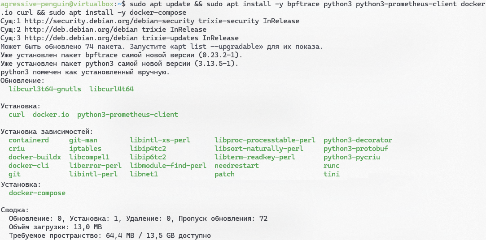

Рисунок 1 - Установка пакетов

### 2.2 Проверка версий

После установки проверены версии трех инструментов:

```bash
bpftrace --version
docker --version
docker compose version
```

Результат на рисунке 2. bpftrace v0.23.2, Docker 26.1.5+dfsg1, Docker Compose 2.26.1-4.

Проверка версий тут не формальность. Compose версии 2 понимает синтаксис файла без поля version и команду `docker compose` через пробел. bpftrace свежей версии нужен для корректной работы с tracepoints и kprobes на ядре 6.12.

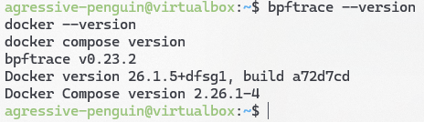

Рисунок 2 - Проверка версий инструментов

### 2.3 Docker без sudo

Чтобы не писать sudo перед каждой командой Docker, включен демон и добавил пользователь в группу docker:

```bash
sudo systemctl enable --now docker
```

Команда `enable --now` одновременно ставит автозапуск и стартует службу сразу.

```bash
sudo usermod -aG docker $USER
```

`usermod -aG` добавляет пользователя в дополнительную группу, не убирая его из остальных. Группа docker дает доступ к сокету демона без sudo.

```bash
newgrp docker
```

Новая группа применяется только к новым сессиям. `newgrp docker` открывает подоболочку с уже примененной группой, чтобы не перелогиниваться.

```bash
docker ps
```

Пустой список контейнеров на рисунке 3 подтверждает, что демон отвечает и права работают. Контейнеров пока нет, они появятся позже.

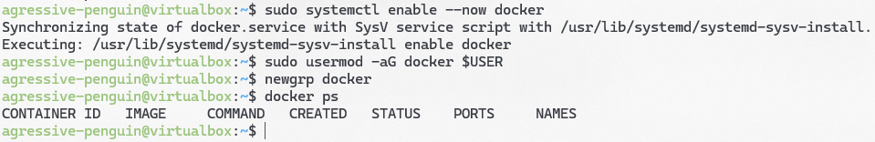

Рисунок 3 - Настройка Docker и проверка доступа без sudo

---

## 3 Сбор метрик через eBPF

### 3.1 Программа collector.bt

Создана рабочая папка и файл программы трассировки:

```bash
mkdir -p ~/lab3/grafana/provisioning/datasources
cd ~/lab3
nano collector.bt
```

`mkdir -p` создает сразу всю вложенность каталогов, включая папку для Grafana, которая понадобится позже. Команда на рисунке 4.

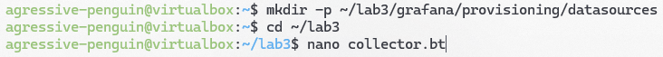

Рисунок 4 - Создание рабочей папки и открытие collector.bt

Содержимое collector.bt приведено ниже.

```text
tracepoint:sched:sched_process_fork
{
    @forks = count();
}

tracepoint:sched:sched_process_exec
{
    @execs = count();
}

tracepoint:sched:sched_switch
{
    @sched_switches = count();
}

tracepoint:sched:sched_wakeup
{
    @sched_wakeups = count();
}

tracepoint:syscalls:sys_enter_openat
{
    @file_opens = count();
}

kprobe:vfs_read
{
    @file_reads = count();
    @read_bytes = sum(arg2);
}

kprobe:vfs_write
{
    @file_writes = count();
    @write_bytes = sum(arg2);
}

interval:s:5
{
    print(@forks);
    print(@execs);
    print(@sched_switches);
    print(@sched_wakeups);
    print(@file_opens);
    print(@file_reads);
    print(@file_writes);
    print(@read_bytes);
    print(@write_bytes);
}
```

Разберем каждый блок.

`tracepoint:sched:sched_process_fork` срабатывает на каждое рождение задачи через fork или clone. Это прямой наследник счетчика из второй работы. `@forks = count()` увеличивает счетчик в eBPF map на единицу.

`tracepoint:sched:sched_process_exec` ловит успешный execve, то есть момент, когда процесс начинает исполнять новую программу. Рождение и исполнение это разные события, и их полезно видеть раздельно.

`tracepoint:sched:sched_switch` считает переключения контекста. Каждый вызов планировщика снимает одну задачу с процессора и ставит другую. Это показатель активности планировщика.

`tracepoint:sched:sched_wakeup` считает пробуждения задач. Задача, ждавшая события, переходит в runnable и получает шанс встать на процессор. Вместе с переключениями это дает картину нагрузки на планировщик.

`tracepoint:syscalls:sys_enter_openat` ловит вход в системный вызов openat. Современная glibc открывает файлы именно через openat, поэтому этот счетчик покрывает почти все открытия файлов.

`kprobe:vfs_read` и `kprobe:vfs_write` цепляются к функциям чтения и записи слоя VFS. Здесь кроме числа операций я считаю байты через `sum(arg2)`. На x86_64 третий аргумент этих функций, то есть arg2, содержит размер запрошенной операции. Это дает байты на уровне VFS, а не на уровне диска.

`interval:s:5` раз в пять секунд печатает все накопленные maps. Значения кумулятивные, они растут с момента старта программы. Период пять секунд выбран не случайно: с таким же периодом Prometheus будет забирать метрики, и гранулярность ряда совпадает с гранулярностью сбора.

Сводка счетчиков приведена в таблице 1.

Таблица 1 - Собираемые счетчики и их источники

| Map в bpftrace  | Метрика Prometheus          | Источник           | Что считает            |
|-----------------|-----------------------------|--------------------|------------------------|
| @forks          | ebpf_process_forks_total    | sched_process_fork | рождения процессов     |
| @execs          | ebpf_process_execs_total    | sched_process_exec | исполнения программ    |
| @sched_switches | ebpf_sched_switches_total   | sched_switch       | переключения контекста |
| @sched_wakeups  | ebpf_sched_wakeups_total    | sched_wakeup       | пробуждения задач      |
| @file_opens     | ebpf_file_opens_total       | sys_enter_openat   | открытия файлов        |
| @file_reads     | ebpf_file_reads_total       | vfs_read           | операции чтения        |
| @file_writes    | ebpf_file_writes_total      | vfs_write          | операции записи        |
| @read_bytes     | ebpf_file_read_bytes_total  | vfs_read, arg2     | байты чтения           |
| @write_bytes    | ebpf_file_write_bytes_total | vfs_write, arg2    | байты записи           |

Частичное содержимое файла в редакторе на рисунке 5.

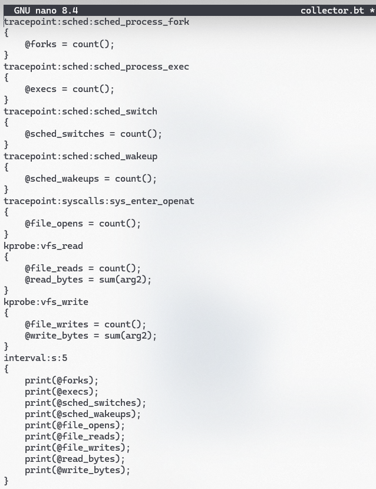

Рисунок 5 - Содержимое collector.bt

### 3.2 Экспортер на Python

Сам по себе bpftrace печатает числа в stdout, Prometheus такой вывод не понимает. Нужен посредник, который превратит печать в формат Prometheus и отдаст его по HTTP. Эту роль играет экспортер на Python.

Он сделан на библиотеке prometheus_client, официальной клиентской библиотеке Prometheus для Python. Она сама поднимает HTTP-сервер и сама формирует корректный текстовый формат. Это и есть разрешенная кастомная интеграция, без всяких текстовых файлов.

Полный листинг экспортера вынесен в приложение А. Разберем логику по кускам. Фрагмент файла в редакторе показан на рисунке 6.

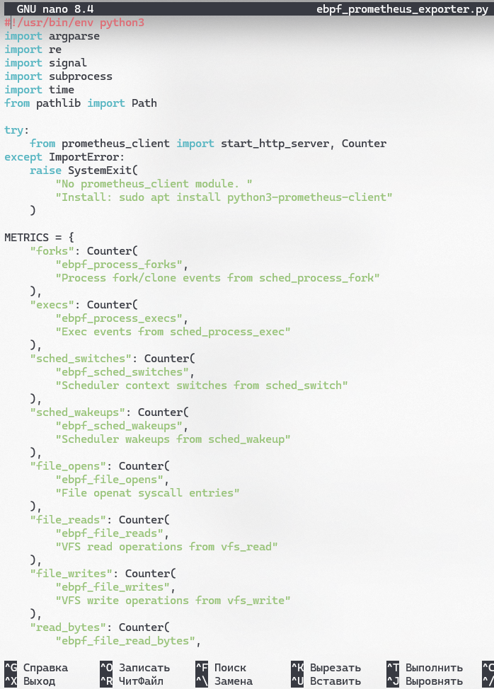

Рисунок 6 - Фрагмент экспортера в редакторе

Словарь METRICS связывает короткие ключи с объектами Counter. Имя счетчика задается без суффикса, библиотека сама добавляет `_total` при выводе. Поэтому в конфиге и в запросах дальше фигурируют имена с `_total`.

Функция запуска bpftrace собирает команду так:

```python
cmd = ["stdbuf", "-oL", "bpftrace", str(bt_path)]
```

`stdbuf -oL` принудительно ставит построчную буферизацию вывода. Без него bpftrace через pipe может копить вывод блоками, и значения приходили бы рывками раз в несколько интервалов. stderr я сливаю в stdout, чтобы ошибки трассировки попадали в лог экспортера и их можно было увидеть.

Основной цикл читает вывод построчно и ищет значения регулярными выражениями вида `@forks:\s*(\d+)`. Для каждого ключа хранится последнее увиденное значение. Прирост вычисляется как разница между новым и прошлым значением, и именно прирост добавляется в Counter через `inc(delta)`.

Такое разделение нужно потому, что bpftrace печатает кумулятивные значения, а Counter в библиотеке умеет только прибавлять. Если bpftrace перезапустится и его значения сбросятся, код видит уменьшение и трактует его как сброс, добавляя новое значение целиком. Благодаря этому счетчик Prometheus остается монотонным даже через перезапуск трассировки.

Обработчики сигналов SIGINT и SIGTERM завершают дочерний bpftrace перед выходом. Иначе после остановки экспортера в системе остались бы висеть активные probes.

Если bpftrace завершился сам, цикл ждет две секунды и поднимает его заново. Это дает экспортеру переживать случайные падения трассировки.

### 3.3 Запуск и проверка

Файл сделан исполняемым, запущен экспортер с правами root, потому что eBPF требует привилегий:

```bash
chmod +x ebpf_prometheus_exporter.py
sudo python3 ./ebpf_prometheus_exporter.py
```

Лог запуска на рисунке 7. Видно строку `Attaching 8 probes`, это восемь блоков программы трассировки. Дальше идут строки вида `sched_switches total=1303 delta=766`. Это кумулятивное значение и прирост за последний интервал. По delta удобно читать живую активность: за пять секунд планировщик сделал 766 переключений.

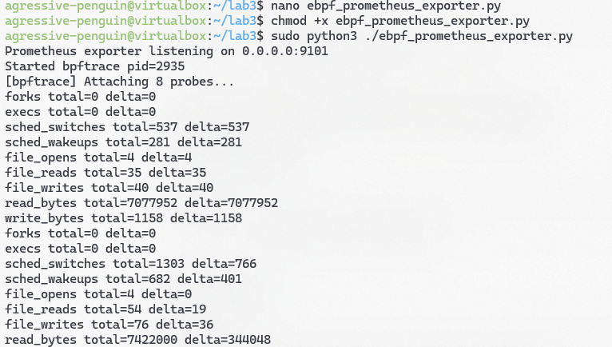

Рисунок 7 - Запуск экспортера и живой лог приростов

Во втором терминале проверен эндпоинт:

```bash
curl -s localhost:9101/metrics | grep -E '^ebpf_'
```

`-s` убирает прогресс-бар curl, grep оставляет только мои метрики. Результат двух запусков на рисунке 8.

Первый запуск показал нули по всем счетчикам. Это нормально: клиентская библиотека только что создала счетчики, а bpftrace еще не успел напечатать первый интервал. Строки `_created` рядом с каждым счетчиком это служебные метки времени создания, их библиотека добавляет сама.

Второй запуск, уже через несколько секунд, показал живые числа. Значения байтов выводятся в экспоненциальной записи, например 3.7774009e+07, это особенность текстового формата Prometheus, который оперирует числами с плавающей точкой.

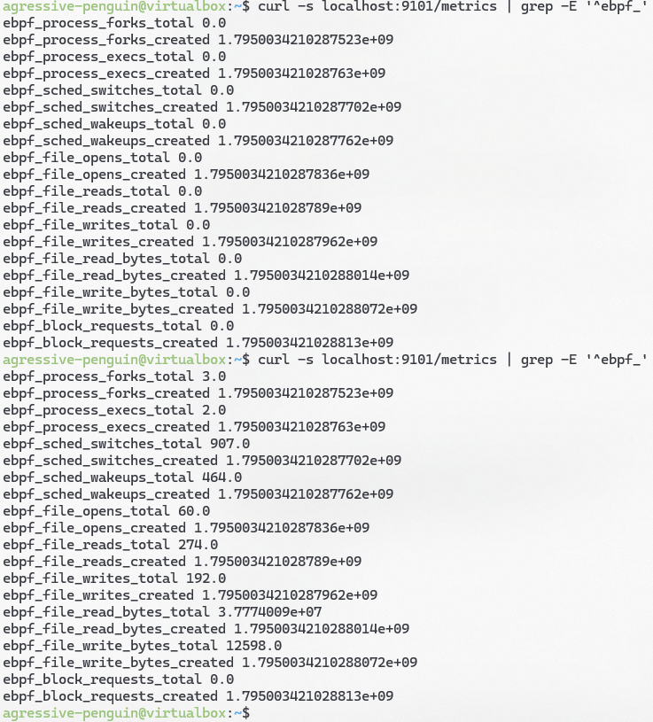

Рисунок 8 - Вывод метрик сразу после старта и через несколько секунд

---

## 4 Хранение метрик в Prometheus

### 4.1 Конфиг Prometheus

Конфиг:

```bash
nano prometheus.yml
```

Содержимое:

```yaml
global:
  scrape_interval: 5s
  evaluation_interval: 5s

scrape_configs:
  - job_name: ebpf-host
    static_configs:
      - targets: ["host.docker.internal:9101"]
        labels:
          instance: "debian-host"
```

`scrape_interval: 5s` задает период опроса экспортера. Я выставил его равным периоду печати bpftrace, чтобы ряд имел ту же гранулярность, что и сбор. `evaluation_interval` задает период вычисления правил, здесь он совпадает со scrape для простоты.

`job_name: ebpf-host` именует задачу опроса. По этому имени метрики группируются в интерфейсе.

`targets` указывает адрес экспортера. Имя `host.docker.internal` нужно потому, что Prometheus живет в контейнере, а экспортер на хосте. Из контейнера localhost это сам контейнер, а не хост. Специальное имя host.docker.internal через механизм host-gateway отображается на адрес хоста со стороны docker-моста.

Метка `instance: debian-host` задает понятное имя экземпляра вместо голого адреса.

Файл в редакторе показан на рисунке 9.

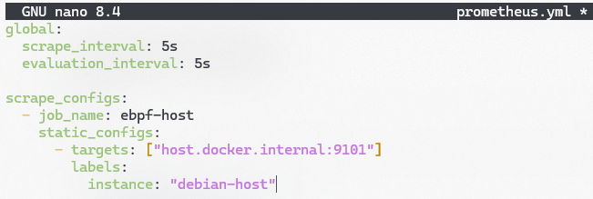

Рисунок 9 - Конфиг Prometheus

### 4.2 Provisioning datasource для Grafana

Чтобы не настраивать источник данных в Grafana руками, файл в provisioning:

```bash
nano grafana/provisioning/datasources/prometheus.yml
```

Содержимое:

```yaml
apiVersion: 1

datasources:
  - name: Prometheus
    type: prometheus
    access: proxy
    url: http://prometheus:9090
    isDefault: true
    editable: true
```

`access: proxy` означает, что запросы к Prometheus делает сам сервер Grafana, а не браузер пользователя. Поэтому браузеру не нужен прямой доступ к Prometheus.

`url: http://prometheus:9090` использует внутреннее имя сервиса из Compose. Docker поднимает свою DNS-сеть, и контейнеры видят друг друга по именам сервисов.

`isDefault: true` делает этот источник выбранным по умолчанию при создании панелей. `editable: true` разрешает править его через интерфейс.

Файл в редакторе показан на рисунке 10.

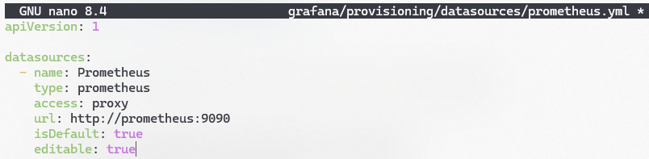

Рисунок 10 - Файл provisioning источника данных

### 4.3 Файл docker-compose.yml

Связку контейнеров я описал в Compose-файле:

```bash
nano docker-compose.yml
```

Содержимое:

```yaml
services:
  prometheus:
    image: prom/prometheus:latest
    container_name: lab3-prometheus
    extra_hosts:
      - "host.docker.internal:host-gateway"
    ports:
      - "9090:9090"
    volumes:
      - ./prometheus.yml:/etc/prometheus/prometheus.yml:ro
      - prometheus-data:/prometheus
    command:
      - --config.file=/etc/prometheus/prometheus.yml
      - --storage.tsdb.path=/prometheus
    restart: unless-stopped

  grafana:
    image: grafana/grafana:latest
    container_name: lab3-grafana
    extra_hosts:
      - "host.docker.internal:host-gateway"
    ports:
      - "3000:3000"
    environment:
      - GF_SECURITY_ADMIN_USER=admin
      - GF_SECURITY_ADMIN_PASSWORD=admin
    volumes:
      - grafana-data:/var/lib/grafana
      - ./grafana/provisioning:/etc/grafana/provisioning:ro
    depends_on:
      - prometheus
    restart: unless-stopped

volumes:
  prometheus-data:
  grafana-data:
```

Ключевые места.

`extra_hosts` с записью host-gateway добавляет в /etc/hosts контейнера имя host.docker.internal, указывающее на хост. Без этой записи имя не разрешалось бы на Linux.

`ports` пробрасывает порт контейнера на хост. Благодаря этому открывались интерфейсы с другой машины по адресу 192.168.0.102.

Тома двух типов. Конфиги смонтированы с суффиксом `:ro`, только чтение, чтобы контейнер не мог их испортить. Именованные тома prometheus-data и grafana-data хранят данные TSDB и настройки Grafana и переживают пересоздание контейнеров.

`command` у Prometheus задает путь к конфигу и каталог хранения TSDB.

`environment` у Grafana задает начальные учетные данные администратора. Они действуют только до первой смены пароля.

`depends_on` задает порядок старта, Grafana стартует после Prometheus. Это порядок запуска, а не гарантия готовности, но для данной связки его достаточно.

`restart: unless-stopped` поднимает контейнер после падения или перезагрузки демона, пока не остановят вручную.

Файл в редакторе показан на рисунке 11.

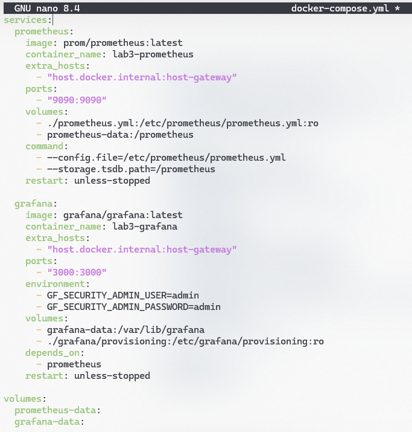

Рисунок 11 - Файл docker-compose.yml

### 4.4 Запуск контейнеров

Перед запуском был остановлен экспортер комбинацией Ctrl+C, чтобы освободить терминал для правки конфигов. Это видно по символу ^C в верхней части рисунка 12. Дальше поправлены конфиги и поднята связка:

```bash
docker compose up -d
```

Флаг `-d` запускает контейнеры в фоне. При первом запуске Compose качает образы, прогресс загрузки слоев виден на рисунке 12.

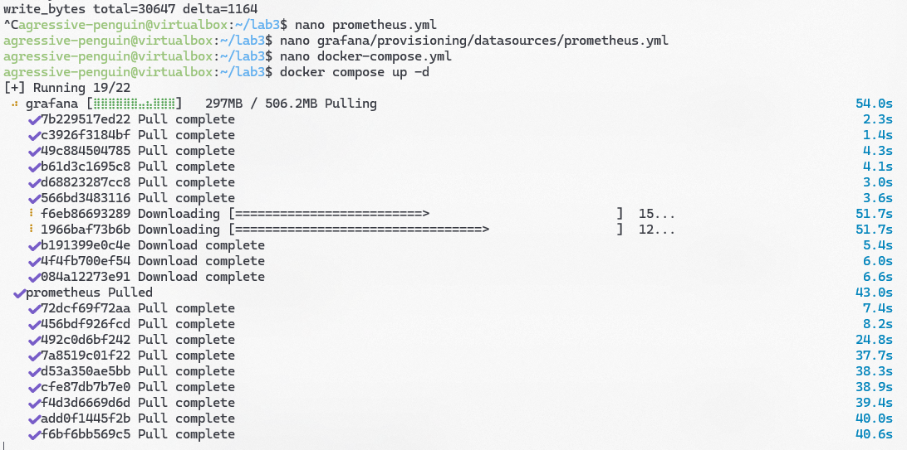

Рисунок 12 - Остановка экспортера, правка конфигов и загрузка образов

Результат старта на рисунке 13. Compose создал сеть lab3_default, два именованных тома и оба контейнера.

```bash
docker compose ps
```

Вывод ps показывает проброшенные порты 0.0.0.0:3000 и 0.0.0.0:9090. Оба сервиса в состоянии Up.

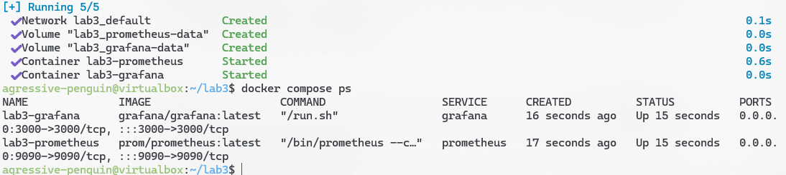

Рисунок 13 - Созданные ресурсы и состояние контейнеров

### 4.5 Логи контейнеров

Логи обоих сервисов:

```bash
docker compose logs -f prometheus
docker compose logs -f grafana
```

Флаг `-f` продолжает вывод в реальном времени.

Лог Prometheus на рисунке 14. По нему видно версию 3.16.0, строку ядра хоста, старт TSDB с проигрыванием WAL, retention по умолчанию 15d и успешную загрузку конфига. Строка Server is ready to receive web requests подтверждает готовность.

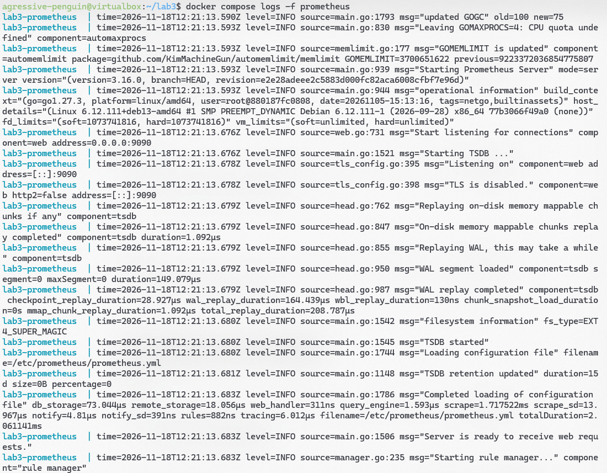

Рисунок 14 - Лог Prometheus

Лог Grafana на рисунке 15. Видно версию 13.3.1 и переопределение настроек через переменные окружения, включая путь provisioning и учетные данные, пароль в логе замаскирован. Это подтверждает, что provisioning и начальные креды подхватились.

.png)

Рисунок 15 - Лог Grafana

### 4.6 Погашенный экспортер и статус DOWN

После старта контейнеров открыта страница целей Prometheus, там DOWN. Ошибка на рисунке 16: connection refused при попытке сходить на host.docker.internal:9101.

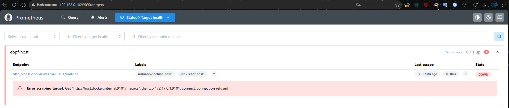

Рисунок 16 - Цель в состоянии DOWN

Причина оказалась не в сети. Порт и эндпоинт на хосте проверены командами:

```bash
ss -ltnp | grep 9101
curl -s localhost:9101/metrics | grep -E '^ebpf_'
```

Обе команды ничего не вывели. Никто не слушал порт 9101. Экспортер был выключен: он остановлен раньше, чтобы освободить терминал под правку конфигов. Имя host.docker.internal при этом разрешалось корректно в 172.17.0.1, то есть сеть была исправна, не хватало только самого экспортера.

Экспортер снова был запущен, и цель перешла в UP, как на рисунке 17. Last scrape показывает свежий опрос длительностью пару миллисекунд.

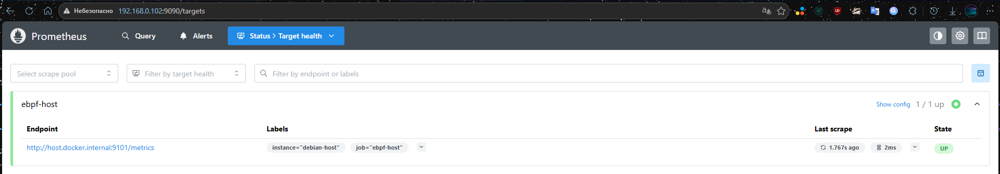

Рисунок 17 - Цель в состоянии UP после перезапуска экспортера

Этот случай научил простой вещи: экспортер должен работать постоянно, иначе ряды обрываются.

---

## 5 Визуализация в Grafana

### 5.1 Вход и смена пароля

Открыта Grafana по адресу 192.168.0.102:3000 и логинимся по admin/admin. Первая попытка не удалась из-за опечатки, интерфейс показал Login failed, как на рисунке 18. Со второй попытки вход прошел.

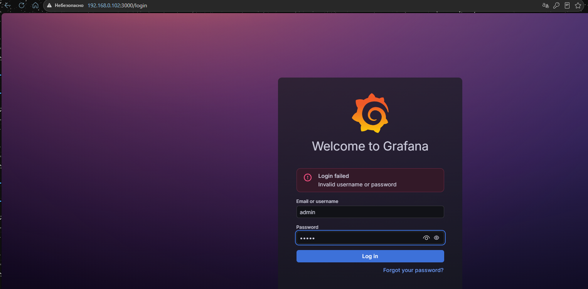

Рисунок 18 - Первая попытка входа

После входа Grafana потребовала сменить пароль, потому что дефолтный пароль она считает небезопасным. Был поставлен student/student, как на рисунке 19. Переменные окружения задают только начальный пароль, дальше действует уже новый.

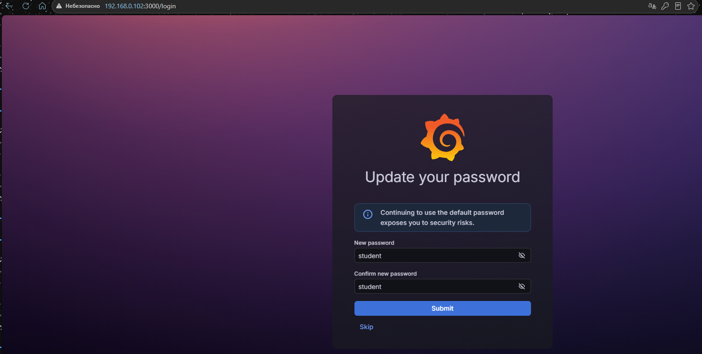

Рисунок 19 - Смена пароля на student

### 5.2 Создание дашборда

На главной странице нажато Create your first dashboard, рисунок 20.

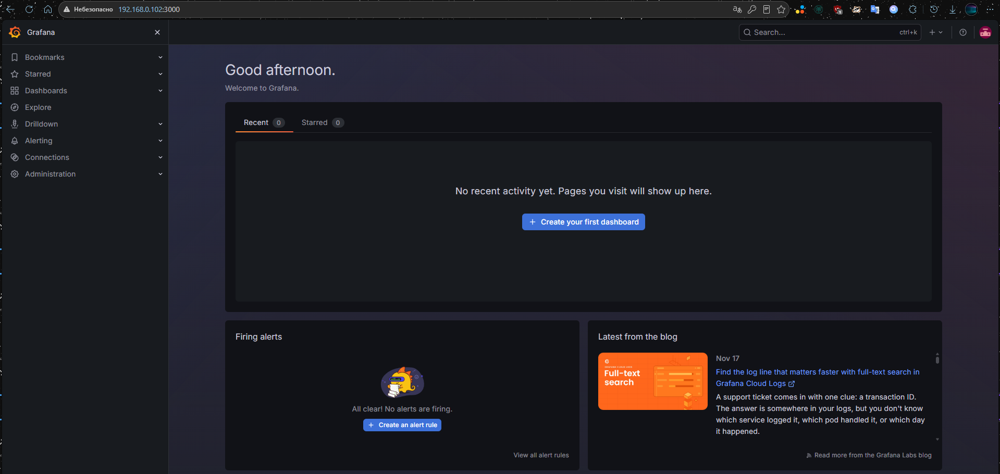

Рисунок 20 - Главная страница и создание дашборда

Дальше "добавить панель", рисунок 21, и перейдем к настройке визуализации, рисунок 22. Дашборд назван From prometeus. Опечатку в слове заметил уже после сохранения и оставил как есть, на работу она не влияет.

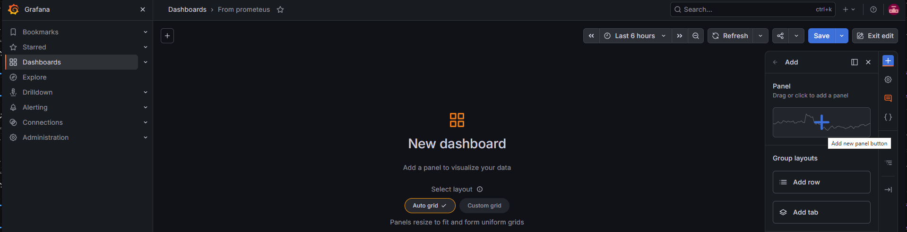

Рисунок 21 - Добавление панели

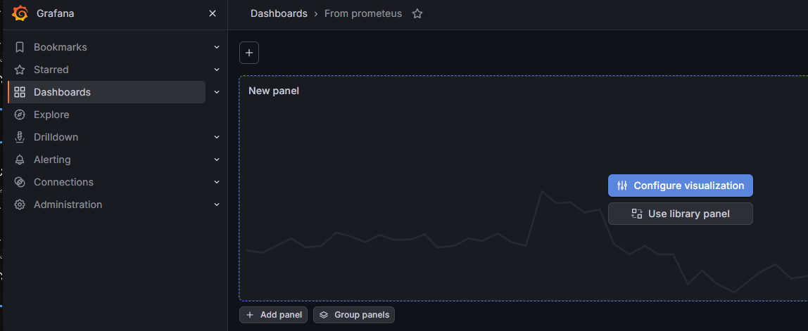

Рисунок 22 - Переход к настройке визуализации

### 5.3 Панель процессов

Первая панель показывает скорость рождений и исполнений. Редактор запросов переключен в режим Code и сделано два запроса, рисунок 23.

```promql
rate(ebpf_process_forks_total[1m])
rate(ebpf_process_execs_total[1m])
```

Легенды подписаны fork/s и exec/s.

Функция rate берет кумулятивный счетчик и считает среднюю скорость прироста за окно. Окно 1m при scrape 5s содержит около двенадцати точек, этого хватает для устойчивой линии. Выбран rate, а не increase, потому что скорость в секунду удобнее сравнивать между панелями. Сырой счетчик здесь мало что показывает, он просто монотонно растет.

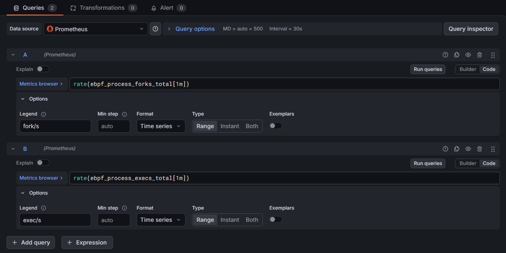

Рисунок 23 - Запросы панели процессов

### 5.4 Панель планировщика

Вторая панель показывает активность планировщика, рисунок 24.

```promql
rate(ebpf_sched_switches_total[1m])
rate(ebpf_sched_wakeups_total[1m])
```

Легенды context switches/s и wakeups/s.

Это не утилизация процессора в процентах, а число событий планировщика в секунду. Он прямо отражает, как часто ядро переключает и пробуждает задачи.

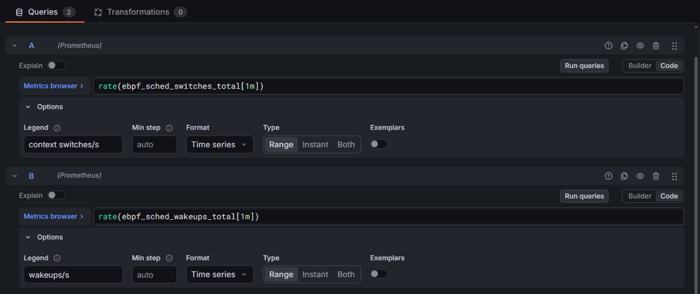

Рисунок 24 - Запросы панели планировщика

### 5.5 Панель файловых операций

Третья панель собирает три запроса, рисунок 25.

```promql
rate(ebpf_file_opens_total[1m])
rate(ebpf_file_reads_total[1m])
rate(ebpf_file_writes_total[1m])
```

Легенды open/s, read/s и write/s. Панель показывает частоту файловых операций на уровне VFS.

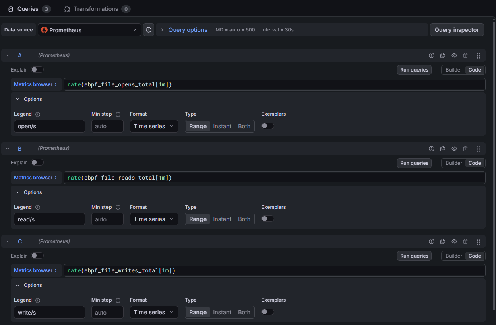

Рисунок 25 - Запросы панели файловых операций

### 5.6 Панель байтов и единицы измерения

Четвертая панель считает байты, рисунок 26.

```promql
rate(ebpf_file_read_bytes_total[1m])
rate(ebpf_file_write_bytes_total[1m])
```

Легенды read bytes/s и write bytes/s.

Сырые числа тут большие и нечитаемые, поэтому для этой панели выставлены единицы измерения. В правой колонке редактора панели в секции Standard options, поле Unit, и выбрано bytes/sec(IEC), рисунок 27. Вариант IEC считает по 1024 и дает KiB/s и MiB/s, что привычнее для размеров файлов. Остальным панелям байтовые единицы не нужны, у них штуки в секунду.

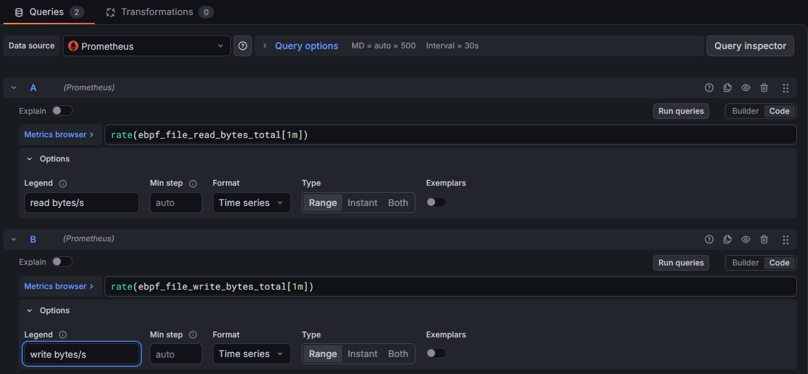

Рисунок 26 - Запросы панели байтов

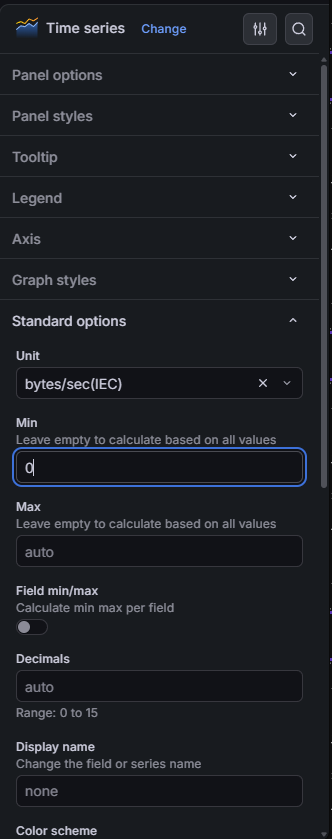

Рисунок 27 - Выбор единиц bytes/sec(IEC)

### 5.7 Итоговый дашборд

Итоговый вид дашборда на рисунке 28. Четыре панели стоят в две строки. Сводка панелей приведена в таблице 2.

Таблица 2 - Панели дашборда

| Панель                 | Запросы                          | Единицы        |
|------------------------|----------------------------------|----------------|
| Process fork/exec rate | rate по forks и execs            | штуки/с        |
| Scheduler activity     | rate по switches и wakeups       | штуки/с        |
| File operations rate   | rate по opens, reads, writes     | штуки/с        |
| File I/O bytes rate    | rate по read_bytes и write_bytes | bytes/sec(IEC) |

Отдельную нагрузку никто не генерировал. Графики шевелятся сами, потому что система живет: работают демоны, journald, сами контейнеры Prometheus и Grafana. Всплеск около 17:36 совпал с моментом, когда открывалась Grafana и производился логин. В этот момент сервер читает и пишет свои файлы настроек и дашбордов, отсюда пики открытий, чтений и записей. Это хороший побочный результат: конвейер ловит реальную активность.

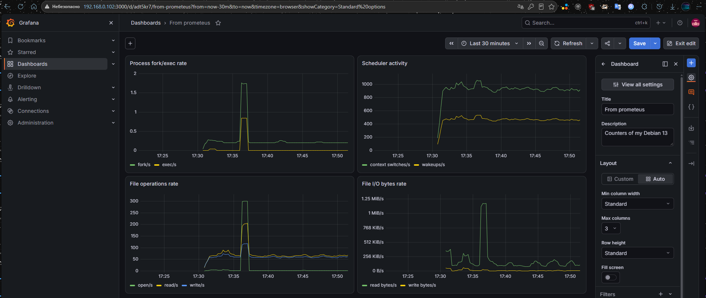

Рисунок 28 - Итоговый дашборд с четырьмя панелями

---

## 6 Оценка результатов и возникшие трудности

### 6.1 Числовые результаты

Возьмем второй снимок curl с рисунка 8 как опорные числа. За несколько секунд работы экспортер накопил такие значения.

Рождений процессов 3, исполнений 2. Разница в единицу объясняется тем, что не всякий fork заканчивается запуском новой программы: оболочка может создать дочерний процесс без exec. Даже на простаивающей машине эти события есть, и ps их пропустил бы, что согласуется с выводом второй работы.

Переключений контекста 907, пробуждений 464. Это фоновая активность планировщика: таймеры, рабочие потоки ядра, обслуживание контейнеров. Отношение переключений к пробуждениям примерно два к одному, что разумно для спокойной системы.

Открытий файлов 60, чтений 274, записей 192. Чтения преобладают над записями, потому что процессы постоянно читают библиотеки, конфиги и данные, а запись чаще отложена.

Байты чтения 37 774 009, это около 36 МиБ. Байты записи 12 598, около 12 КиБ. Перекос большой, но объяснимый. Счетчики стоят на уровне VFS и считают запрошенные байты в момент вызова, а не байты, дошедшие до диска. Запись буферизуется page cache и сбрасывается позже, поэтому на момент снимка ее видно мало. Чтение же сразу тянет данные, в том числе из кэша.

Живой лог экспортера с рисунка 7 подтверждает динамику: за один пяти секундный интервал переключения выросли с 537 до 1303, то есть на 766, а байты чтения на 3 444 048. Это порядка 150 переключений в секунду и около 0.7 МиБ чтения в секунду в фоне.

### 6.2 Ограничения метода

Подсчет байтов через arg2 привязан к соглашению о аргументах x86_64. На другой архитектуре позиция аргумента может отличаться, и программу придется править.

Байты считаются на уровне VFS, а не на уровне блочного устройства. Это байты, запрошенные процессами, а не байты, реально дошедшие до диска. Для мониторинга активности процессов это то, что нужно, но для нагрузки на диск потребовались бы другие точки трассировки.

Гранулярность ряда ограничена пятью секундами. Более быстрые всплески внутри интервала усредняются.

При перезапуске самого экспортера клиентские счетчики сбрасываются, и ряд начинает с нуля. Prometheus умеет обрабатывать такие сбросы, но непрерывность ряда при частых перезапусках страдает.

Образы взяты с тегом latest. Для воспроизводимой сборки теги стоило бы зафиксировать.

Метки по CPU или по PID не добавлены, все счетчики скалярные. Для более тонкого анализа пришлось бы усложнять программу трассировки и формат вывода.

---

## ЗАКЛЮЧЕНИЕ

Все поставленные задачи выполнены. Собрано девять счетчиков системных событий через eBPF, они покрывают процессы, планировщик, файловые операции и байты чтения и записи. Доставка в Prometheus сделана собственным экспортером на официальной библиотеке prometheus_client, без запрещенных универсальных экспортеров и текстовых посредников. Prometheus и Grafana развернуты в контейнерах Docker через Compose. Построен дашборд из четырех панелей, графики строятся по живым рядам.

Конвейер показал работоспособность на простаивающей виртуальной машине без искусственной нагрузки. Он ловит фоновую активность системы и всплески, связанные с действиями пользователя, что видно на итоговом дашборде.

По дальнейшему использованию результатов есть несколько рекомендаций. Экспортер стоит оформить как службу systemd, чтобы он не зависел от открытого терминала и переживал перезагрузку. Теги образов стоит зафиксировать для воспроизводимости. При необходимости более тонкого анализа можно добавить метки по CPU и перейти на специализированный eBPF-экспортер, если захочется убрать самодельный посредник совсем.

## ПРИЛОЖЕНИЕ А

### Листинг экспортера

Полный листинг файла ebpf_prometheus_exporter.py.

```python
#!/usr/bin/env python3
import argparse
import re
import signal
import subprocess
import time
from pathlib import Path

try:
    from prometheus_client import start_http_server, Counter
except ImportError:
    raise SystemExit(
        "No prometheus_client module. "
        "Install: sudo apt install python3-prometheus-client"
    )

METRICS = {
    "forks": Counter(
        "ebpf_process_forks",
        "Process fork/clone events from sched_process_fork"
    ),
    "execs": Counter(
        "ebpf_process_execs",
        "Exec events from sched_process_exec"
    ),
    "sched_switches": Counter(
        "ebpf_sched_switches",
        "Scheduler context switches from sched_switch"
    ),
    "sched_wakeups": Counter(
        "ebpf_sched_wakeups",
        "Scheduler wakeups from sched_wakeup"
    ),
    "file_opens": Counter(
        "ebpf_file_opens",
        "File openat syscall entries"
    ),
    "file_reads": Counter(
        "ebpf_file_reads",
        "VFS read operations from vfs_read"
    ),
    "file_writes": Counter(
        "ebpf_file_writes",
        "VFS write operations from vfs_write"
    ),
    "read_bytes": Counter(
        "ebpf_file_read_bytes",
        "Bytes requested via vfs_read"
    ),
    "write_bytes": Counter(
        "ebpf_file_write_bytes",
        "Bytes requested via vfs_write"
    ),
    "block_rq": Counter(
        "ebpf_block_requests",
        "Optional block I/O requests from block_rq_issue"
    ),
}

PATTERNS = [
    (re.compile(r"@forks:\s*(\d+)"), "forks"),
    (re.compile(r"@execs:\s*(\d+)"), "execs"),
    (re.compile(r"@sched_switches:\s*(\d+)"), "sched_switches"),
    (re.compile(r"@sched_wakeups:\s*(\d+)"), "sched_wakeups"),
    (re.compile(r"@file_opens:\s*(\d+)"), "file_opens"),
    (re.compile(r"@file_reads:\s*(\d+)"), "file_reads"),
    (re.compile(r"@file_writes:\s*(\d+)"), "file_writes"),
    (re.compile(r"@read_bytes:\s*(\d+)"), "read_bytes"),
    (re.compile(r"@write_bytes:\s*(\d+)"), "write_bytes"),
    (re.compile(r"@block_rq:\s*(\d+)"), "block_rq"),
]

CURRENT_PROC = None


def signal_handler(signum, frame):
    if CURRENT_PROC is not None:
        CURRENT_PROC.terminate()
    raise SystemExit(0)


signal.signal(signal.SIGINT, signal_handler)
signal.signal(signal.SIGTERM, signal_handler)


def main():
    global CURRENT_PROC

    parser = argparse.ArgumentParser(
        description="eBPF to Prometheus exporter using bpftrace"
    )
    parser.add_argument("--addr", default="0.0.0.0")
    parser.add_argument("--port", type=int, default=9101)
    parser.add_argument(
        "--bt",
        default=str(Path(__file__).resolve().parent / "collector.bt")
    )
    args = parser.parse_args()

    bt_path = Path(args.bt)
    if not bt_path.is_file():
        raise SystemExit(f"bpftrace file not found: {bt_path}")

    start_http_server(args.port, addr=args.addr)
    print(
        f"Prometheus exporter listening on {args.addr}:{args.port}",
        flush=True
    )

    cmd = ["stdbuf", "-oL", "bpftrace", str(bt_path)]

    while True:
        CURRENT_PROC = subprocess.Popen(
            cmd,
            stdout=subprocess.PIPE,
            stderr=subprocess.STDOUT,
            text=True,
            bufsize=1,
        )
        print(f"Started bpftrace pid={CURRENT_PROC.pid}", flush=True)

        last = {}

        for line in CURRENT_PROC.stdout:
            matched_any = False

            for pattern, key in PATTERNS:
                m = pattern.search(line)
                if not m:
                    continue

                matched_any = True
                val = int(m.group(1))
                prev = last.get(key)

                if prev is None or val < prev:
                    delta = val
                else:
                    delta = val - prev

                if delta > 0:
                    METRICS[key].inc(delta)

                last[key] = val
                print(f"{key} total={val} delta={delta}", flush=True)

            if not matched_any and line.strip():
                print(f"[bpftrace] {line.rstrip()}", flush=True)

        rc = CURRENT_PROC.wait()
        CURRENT_PROC = None
        print(f"bpftrace exited rc={rc}, restarting in 2s", flush=True)
        time.sleep(2)


if __name__ == "__main__":
    main()
```