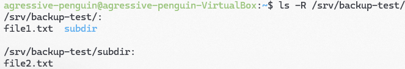
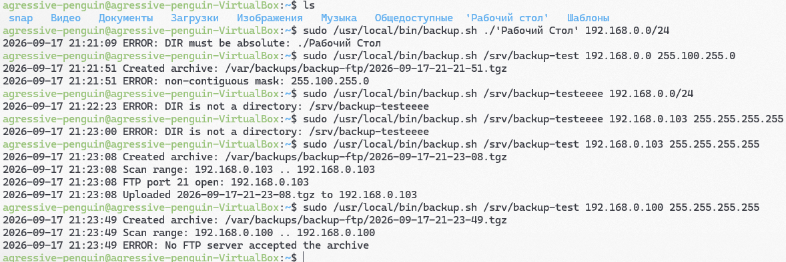
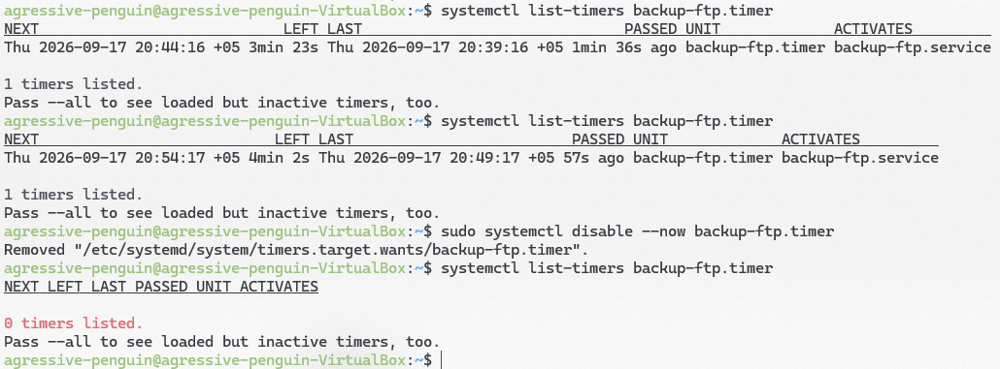
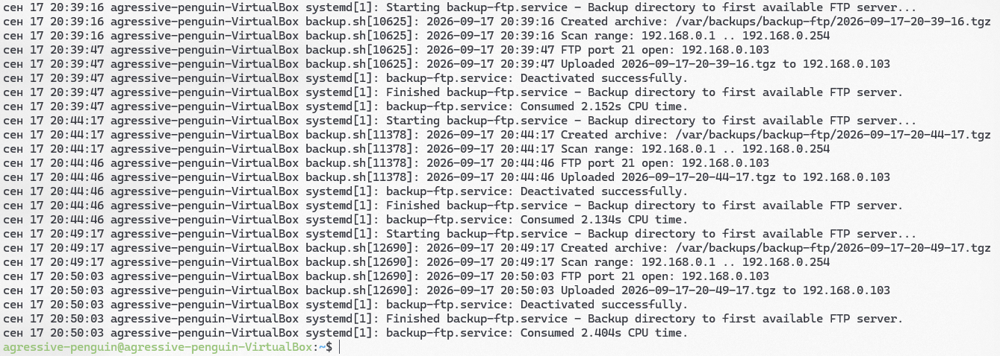
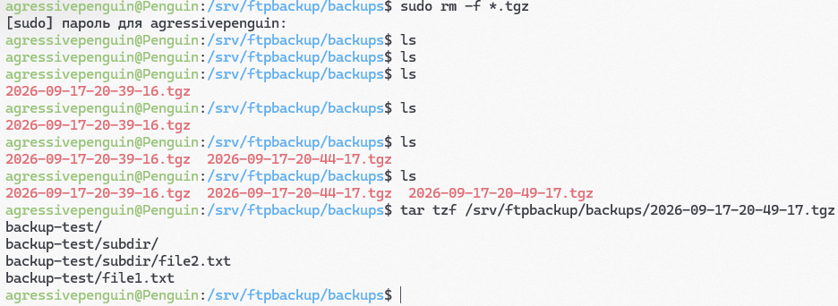
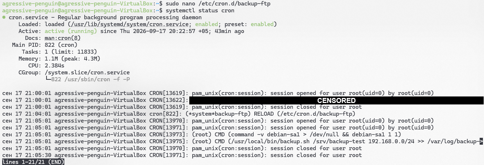
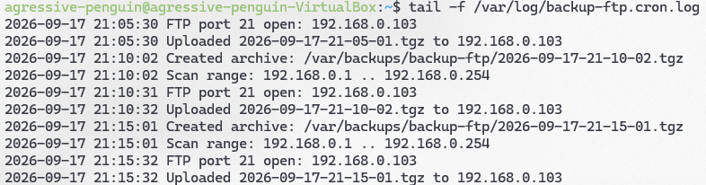
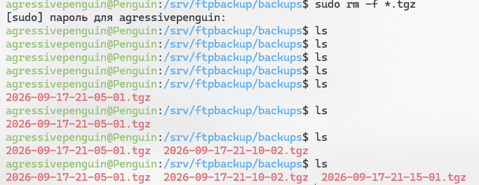

# Лабораторная работа 1 "Shell"

Работу выполнил Южаков Федор, группа ИКС-23-1б.

Все манипуляции производятся на двух машинах, одна на Debian (на ней FTP-сервер, пользователь терминала agressivepenguin@Penguin), другая на Ubuntu (на ней написанный скрипт, пользователь терминала agressive-penguin@agressive-penguin-VirtualBox).

Ниже все идет в хронологическом порядке установки, а еще ниже есть тесты в виде скриншотов работы обеих машин.

## Машина Debian:

### 1) Установка FTP-сервера

sudo apt update
sudo apt install -y vsftpd

### 2) Создание пользователя, папок, настройка прав, паролей

sudo useradd -m -d /srv/ftpbackup -s /usr/sbin/nologin ftpbackup 2>/dev/null || true

grep -qx '/usr/sbin/nologin' /etc/shells || echo '/usr/sbin/nologin' | sudo tee -a /etc/shells >/dev/null

echo 'ftpbackup:parol' | sudo chpasswd

sudo mkdir -p /srv/ftpbackup/backups

sudo chown root:root /srv/ftpbackup
sudo chmod 755 /srv/ftpbackup

sudo chown ftpbackup:ftpbackup /srv/ftpbackup/backups
sudo chmod 755 /srv/ftpbackup/backups

### 2) Создание конфига FTP-сервера

sudo cp /etc/vsftpd.conf /etc/vsftpd.conf.orig

sudo tee /etc/vsftpd.conf >/dev/null <<'EOF'
listen=YES
listen_ipv6=NO

anonymous_enable=NO
local_enable=YES
write_enable=YES
local_umask=022

chroot_local_user=YES
allow_writeable_chroot=YES
local_root=/srv/ftpbackup

pasv_enable=YES
pasv_min_port=40000
pasv_max_port=40100
EOF

### 3) Перезапуск и включение FTP

sudo systemctl restart vsftpd
sudo systemctl enable vsftpd

ss -ltnp | grep ':21'

Должно вывести, что слушает порт.

## Машина Ubuntu

### 1) Создаем файл скрипта

sudo nano /usr/local/bin/backup.sh

```bash
#!/usr/bin/env bash
set -Eeuo pipefail
umask 077

CONFIG=${CONFIG:-/etc/backup-ftp.conf}
if [[ -r $CONFIG ]]; then
    . "$CONFIG"
fi

FTP_PORT=${FTP_PORT:-21}
FTP_DIR=${FTP_DIR:-}
FTP_DIR=${FTP_DIR%/}

ARCHIVE_DIR=${ARCHIVE_DIR:-/var/backups/backup-ftp}
ARCHIVE_DIR=${ARCHIVE_DIR%/}

LOG_FILE=${LOG_FILE:-/var/log/backup-ftp.log}
FTP_TIMEOUT=${FTP_TIMEOUT:-5}

PROBE_TIMEOUT=${PROBE_TIMEOUT:-1}
PROBE_RETRIES=${PROBE_RETRIES:-2}
PROBE_SLEEP=${PROBE_SLEEP:-0.3}

MAX_HOSTS=${MAX_HOSTS:-4096}
LOCK_FILE=${LOCK_FILE:-/var/lock/backup-ftp.lock}

log() {
    local m
    m="$(date '+%F %T') $*"
    echo "$m" >>"$LOG_FILE" 2>/dev/null || true
    echo "$m"
}

die() {
    log "ERROR: $*"
    exit 1
}

usage() {
    cat >&2 <<'USAGE'
Usage:
  backup.sh DIR
  backup.sh DIR NETWORK
  backup.sh DIR IP MASK
  backup.sh DIR IP PREFIX

Examples:
  backup.sh /srv/data
  backup.sh /srv/data 192.168.1.0/24
  backup.sh /srv/data 192.168.1.0 255.255.255.0
  backup.sh /srv/data 192.168.1.10 32
USAGE
    exit 2
}

is_ip() {
    local a b c d
    [[ $1 =~ ^([0-9]{1,3}\.){3}[0-9]{1,3}$ ]] || return 1
    IFS=. read -r a b c d <<<"$1"
    (( 10#$a <= 255 && 10#$b <= 255 && 10#$c <= 255 && 10#$d <= 255 ))
}

ip_to_int() {
    local a b c d
    IFS=. read -r a b c d <<<"$1"
    echo $(( (10#$a << 24) + (10#$b << 16) + (10#$c << 8) + 10#$d ))
}

int_to_ip() {
    printf '%d.%d.%d.%d' \
        $(( ($1 >> 24) & 255 )) \
        $(( ($1 >> 16) & 255 )) \
        $(( ($1 >> 8)  & 255 )) \
        $((  $1        & 255 ))
}

prefix_to_mask_int() {
    local p=$((10#$1))
    if (( p == 0 )); then
        echo 0
    else
        echo $(( (0xFFFFFFFF << (32 - p)) & 0xFFFFFFFF ))
    fi
}

mask_to_prefix() {
    local m=$1 p=0 host
    host=$(( (~m) & 0xFFFFFFFF ))

    # Проверка, что маска континуальная: единицы подряд, затем нули.
    (( (host & (host + 1)) == 0 )) || return 1

    while (( m )); do
        p=$(( p + (m & 1) ))
        m=$(( m >> 1 ))
    done

    echo $p
}

port_open() {
    local ip=$1 i

    # Несколько попыток: помогает, если ARP ещё не отработал.
    for ((i = 0; i < PROBE_RETRIES; i++)); do
        if timeout "$PROBE_TIMEOUT" bash -c "exec 3<>/dev/tcp/${ip}/${FTP_PORT}" 2>/dev/null; then
            return 0
        fi
        sleep "$PROBE_SLEEP"
    done

    return 1
}

FTP_CODE=
FTP_REPLY=

ftp_read() {
    local line code sep

    IFS= read -r -t "$FTP_TIMEOUT" -u 3 line || return 1
    line=${line%$'\r'}

    [[ $line =~ ^([0-9]{3})([ -]) ]] || return 1
    code=${BASH_REMATCH[1]}
    sep=${BASH_REMATCH[2]}

    FTP_CODE=$code
    FTP_REPLY=$line

    if [[ $sep == - ]]; then
        while IFS= read -r -t "$FTP_TIMEOUT" -u 3 line; do
            line=${line%$'\r'}
            FTP_REPLY+=$'\n'$line
            if [[ $line == "$code "* || $line == "$code" ]]; then
                return 0
            fi
        done
        return 1
    fi

    return 0
}

ftp_cmd() {
    local cmd=$1 expect=$2
    printf '%s\r\n' "$cmd" >&3
    ftp_read || return 1
    [[ $FTP_CODE =~ ^(${expect})$ ]]
}

ftp_upload() {
    local ip=$1 file=$2 remote=$3

    (
        exec 3<>"/dev/tcp/${ip}/${FTP_PORT}" || exit 1

        ftp_read || exit 1
        if [[ $FTP_CODE == 120 ]]; then
            ftp_read || exit 1
        fi
        [[ $FTP_CODE == 220 ]] || exit 1

        ftp_cmd "USER ${FTP_USER}" "331|230" || exit 1
        if [[ $FTP_CODE == 331 ]]; then
            ftp_cmd "PASS ${FTP_PASS}" "230" || exit 1
        fi

        if [[ -n $FTP_DIR ]]; then
            ftp_cmd "CWD ${FTP_DIR}" "250" || exit 1
        fi

        ftp_cmd "TYPE I" "200" || exit 1
        ftp_cmd "PASV" "227" || exit 1

        [[ $FTP_REPLY =~ \(([0-9]+),([0-9]+),([0-9]+),([0-9]+),([0-9]+),([0-9]+)\) ]] || exit 1

        local dip="${BASH_REMATCH[1]}.${BASH_REMATCH[2]}.${BASH_REMATCH[3]}.${BASH_REMATCH[4]}"
        local dport=$(( 10#${BASH_REMATCH[5]} * 256 + 10#${BASH_REMATCH[6]} ))

        # Некоторые серверы могут вернуть 0.0.0.0.
        [[ $dip == 0.0.0.0 ]] && dip=$ip

        exec 4<>"/dev/tcp/${dip}/${dport}" || exit 1

        ftp_cmd "STOR ${remote}" "150|125" || {
            exec 4>&- 4<&-
            exit 1
        }

        cat -- "$file" >&4 || {
            exec 4>&- 4<&-
            exit 1
        }

        exec 4>&- 4<&-

        ftp_read || exit 1
        [[ $FTP_CODE == 226 ]] || exit 1

        ftp_cmd "QUIT" "221|226" || true
        exit 0
    )
}

if [[ ${1:-} == -h || ${1:-} == --help ]]; then
    usage
fi

(( $# >= 1 )) || usage

DIR=$1
[[ $DIR == /* ]] || die "DIR must be absolute: $DIR"
[[ -d $DIR ]] || die "DIR is not a directory: $DIR"

DIR=$(cd -P -- "$DIR" 2>/dev/null && pwd) || die "cannot resolve DIR: $1"
[[ $DIR != / ]] || die "will not backup /"

PARENT=$(dirname -- "$DIR")
BASE=$(basename -- "$DIR")

[[ -n $BASE && $BASE != / ]] || die "bad directory"

[[ $ARCHIVE_DIR == /* ]] || die "ARCHIVE_DIR must be absolute"
[[ -n $ARCHIVE_DIR ]] || die "ARCHIVE_DIR is empty"

if [[ $DIR == "$ARCHIVE_DIR" || $DIR == "$ARCHIVE_DIR"/* || $ARCHIVE_DIR == "$DIR"/* ]]; then
    die "ARCHIVE_DIR and DIR must not overlap"
fi

command -v flock >/dev/null || die "flock not found"
exec 9>"$LOCK_FILE" || die "cannot open lock file: $LOCK_FILE"
if ! flock -n 9; then
    log "Another copy is already running, exiting"
    exit 0
fi

mkdir -p -- "$ARCHIVE_DIR"

TS=$(date +%Y-%m-%d-%H-%M-%S)
ARCHIVE_NAME="${TS}.tgz"
ARCHIVE_PATH="$ARCHIVE_DIR/$ARCHIVE_NAME"

if [[ -e $ARCHIVE_PATH ]]; then
    ARCHIVE_NAME="${TS}-$$.tgz"
    ARCHIVE_PATH="$ARCHIVE_DIR/$ARCHIVE_NAME"
fi

TMP_PATH="${ARCHIVE_PATH}.part"
trap 'rm -f -- "${TMP_PATH:-}"' EXIT

rm -f -- "$TMP_PATH"

# Архивируем только последний компонент пути:
# /a/b/c/d/dir -> архив содержит dir/...
tar -czf "$TMP_PATH" -C "$PARENT" -- "$BASE"

mv -- "$TMP_PATH" "$ARCHIVE_PATH"

log "Created archive: $ARCHIVE_PATH"

if (( $# == 1 )); then
    exit 0
fi

IP=""
PREFIX=""
MASK=""

if (( $# == 2 )); then
    if [[ $2 == */* ]]; then
        IP=${2%/*}
        PREFIX=${2#*/}
    else
        IP=$2
        PREFIX=32
    fi
elif (( $# == 3 )); then
    if [[ $2 == */* ]]; then
        die "Use either IP/PREFIX as one argument or IP MASK as two arguments"
    fi
    IP=$2
    if [[ $3 == *.* ]]; then
        MASK=$3
    else
        PREFIX=$3
    fi
else
    usage
fi

is_ip "$IP" || die "bad IP: $IP"

if [[ -n $MASK ]]; then
    is_ip "$MASK" || die "bad mask: $MASK"
    MASK_INT=$(ip_to_int "$MASK")
    PREFIX=$(mask_to_prefix "$MASK_INT") || die "non-contiguous mask: $MASK"
else
    [[ $PREFIX =~ ^[0-9]+$ ]] || die "bad prefix: $PREFIX"
    PREFIX=$((10#$PREFIX))
    (( PREFIX >= 0 && PREFIX <= 32 )) || die "prefix must be 0..32"
    MASK_INT=$(prefix_to_mask_int "$PREFIX")
fi

IP_INT=$(ip_to_int "$IP")
NET_INT=$(( IP_INT & MASK_INT ))
HOSTMASK_INT=$(( (~MASK_INT) & 0xFFFFFFFF ))
BCAST_INT=$(( NET_INT | HOSTMASK_INT ))

if (( PREFIX == 32 )); then
    START=$NET_INT
    END=$NET_INT
elif (( PREFIX == 31 )); then
    START=$NET_INT
    END=$BCAST_INT
else
    START=$(( NET_INT + 1 ))
    END=$(( BCAST_INT - 1 ))
fi

COUNT=$(( END - START + 1 ))
(( COUNT > 0 )) || die "empty IP range"

if (( MAX_HOSTS && COUNT > MAX_HOSTS )); then
    die "range too large: $COUNT hosts > MAX_HOSTS=$MAX_HOSTS"
fi

: "${FTP_USER:?FTP_USER is not set}"
: "${FTP_PASS:?FTP_PASS is not set}"

log "Scan range: $(int_to_ip "$START") .. $(int_to_ip "$END")"

for ((addr = START; addr <= END; addr++)); do
    ip=$(int_to_ip "$addr")

    if port_open "$ip"; then
        log "FTP port ${FTP_PORT} open: $ip"

        if ftp_upload "$ip" "$ARCHIVE_PATH" "$ARCHIVE_NAME"; then
            log "Uploaded $ARCHIVE_NAME to $ip"
	    rm -f -- "$ARCHIVE_PATH"   # Удаление после успеха
            exit 0
        fi

        log "FTP upload failed: $ip"
    fi
done

die "No FTP server accepted the archive"
```

sudo chmod 755 /usr/local/bin/backup.sh

### 2) Конфиг скрипта

sudo nano /etc/backup-ftp.conf

```bash
FTP_USER=ftpbackup
FTP_PASS='parol'
FTP_DIR=backups
FTP_PORT=21

ARCHIVE_DIR=/var/backups/backup-ftp
LOG_FILE=/var/log/backup-ftp.log

FTP_TIMEOUT=5

# Защита от долгого сканирования.
# 0 = без лимита, 4096 по умолчанию
MAX_HOSTS=0

# Настройки пинга
PROBE_TIMEOUT=0.1
PROBE_RETRIES=2
PROBE_SLEEP=0.03
```

sudo chmod 600 /etc/backup-ftp.conf

### 3) Создание папок и файлов, которые мы будем бекапить

sudo mkdir -p /srv/backup-test/subdir
echo "Test file content $(date)" | sudo tee /srv/backup-test/file1.txt > /dev/null
echo "Nested file" | sudo tee /srv/backup-test/subdir/file2.txt > /dev/null
sudo chmod -R o+r /srv/backup-test

### 4) Проверка работы без автоматизаций

sudo /usr/local/bin/backup.sh /srv/backup-test 192.168.0.0/24

На машине Debian должен появиться архив, можно посмотреть их все:

ls -lh /srv/ftpbackup/backups/

Например такой. Можно посмотреть, что внутри:

tar tzf /srv/ftpbackup/backups/2026-09-16-23-20-09.tgz

Допустим:

backup-test/
backup-test/subdir/
backup-test/subdir/file2.txt
backup-test/file1.txt

### 5) Systemd

#### Сервис

sudo nano /etc/systemd/system/backup-ftp.service

```txt
[Unit]
Description=Backup directory to first available FTP server
Wants=network-online.target
After=network-online.target

[Service]
Type=oneshot
ExecStart=/usr/local/bin/backup.sh /srv/backup-test 192.168.0.0/24
EnvironmentFile=-/etc/backup-ftp.conf
Nice=10
IOSchedulingClass=idle
```

#### Таймер на каждые 5 минут

sudo nano /etc/systemd/system/backup-ftp.timer

```txt
[Unit]
Description=Run backup every 5 minutes

[Timer]
OnBootSec=2min
OnUnitActiveSec=5min
AccuracySec=1min
Persistent=true

[Install]
WantedBy=timers.target
```

#### Команды управления

| Действие                                        | Команда                                                                                                                                   |
|-------------------------------------------------|-------------------------------------------------------------------------------------------------------------------------------------------|
| Включить (запустить сейчас + автозагрузка)      | `sudo systemctl enable --now backup-ftp.timer`                                                                                            |
| Выключить (остановить + убрать из автозагрузки) | `sudo systemctl disable --now backup-ftp.timer`                                                                                           |
| Проверить статус таймера                        | `systemctl list-timers backup-ftp.timer`                                                                                                  |
| Посмотреть логи последнего запуска              | `journalctl -u backup-ftp.service -n 50 --no-pager`                                                                                       |
| Запустить вручную вне расписания                | `sudo systemctl start backup-ftp.service`                                                                                                 |
| Полное удаление                                 | `sudo systemctl disable --now backup-ftp.timer && sudo rm /etc/systemd/system/backup-ftp.{service,timer} && sudo systemctl daemon-reload` |

### 6) Cron

sudo nano /etc/cron.d/backup-ftp

```txt
# Backup every 5 minutes
PATH=/usr/local/sbin:/usr/local/bin:/usr/sbin:/usr/bin:/sbin:/bin
SHELL=/bin/bash

*/5 * * * * root /usr/local/bin/backup.sh /srv/backup-test 192.168.0.0/24 >> /var/log/backup-ftp.cron.log 2>&1
```

sudo chmod 644 /etc/cron.d/backup-ftp

#### Команды управления

| Действие                     | Команда                                                               |
|------------------------------|-----------------------------------------------------------------------|
| Включить                     | Файл в `/etc/cron.d/` подхватывается автоматически (в течение минуты) |
| Выключить (без удаления)     | `sudo mv /etc/cron.d/backup-ftp /etc/cron.d/backup-ftp.disabled`      |
| Включить обратно             | `sudo mv /etc/cron.d/backup-ftp.disabled /etc/cron.d/backup-ftp`      |
| Полное удаление              | `sudo rm -f /etc/cron.d/backup-ftp /etc/cron.d/backup-ftp.disabled`   |
| Проверить, что cron работает | `systemctl status cron`                                               |
| Посмотреть логи выполнения   | `tail -f /var/log/backup-ftp.cron.log`                                |

## Тесты со скриншотами

Папка, для которой делаем бекапы `/srv/backup-test`:



Примеры использования без автоматизации (в том числе, корректная обработка неправильного ввода, если при неправильном вводе можно создать архив - он создается и не удаляется, так как это локальный бекап, при успешном создании сетевого бекапа локальный не сохраняется):



### Systemd

Работа скрипта на машине Ubuntu + отключение автоматизации:



Логи:



Что получила машина Debian:



### Cron

Установка и работа Cron на машине Ubuntu:



Логи cron:



Что получила машина Debian:

