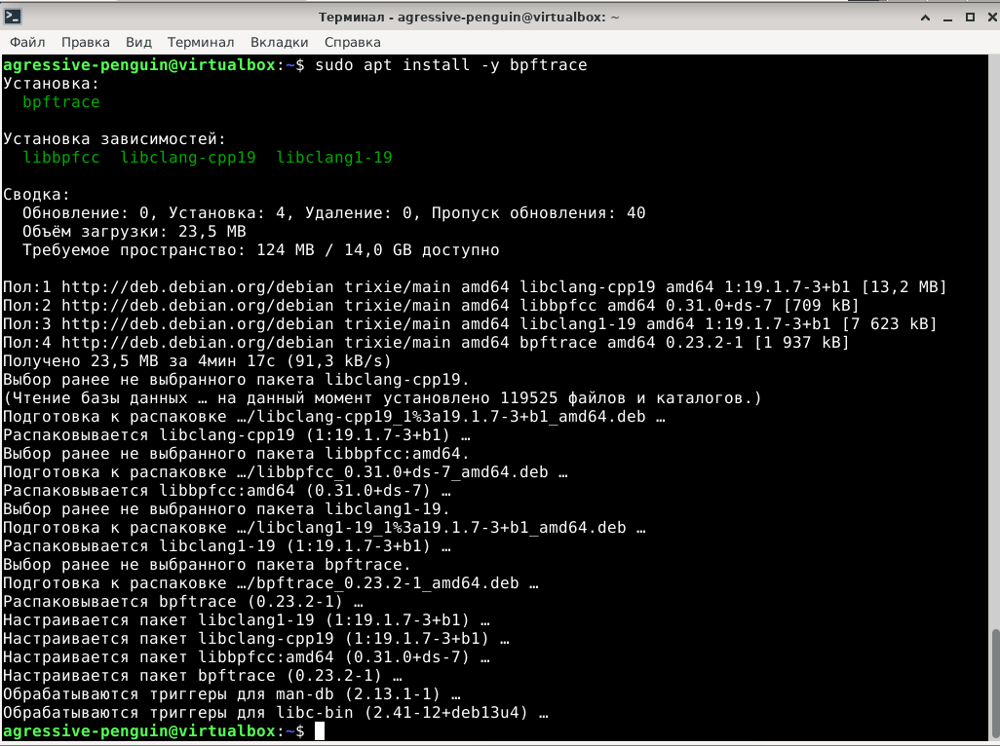
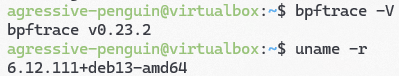
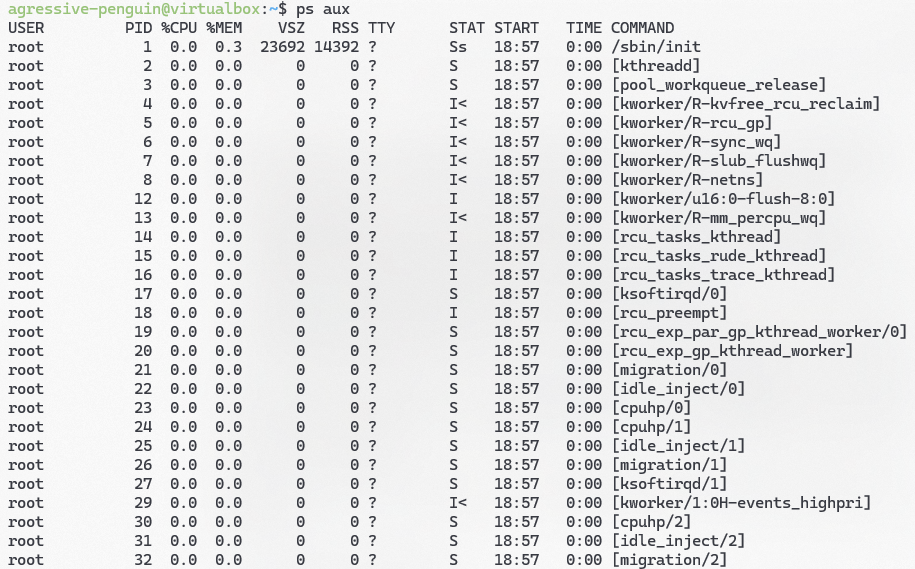
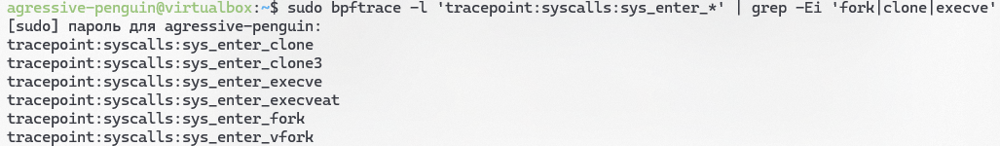
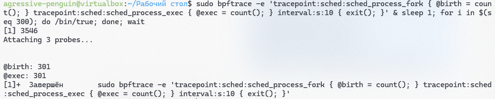
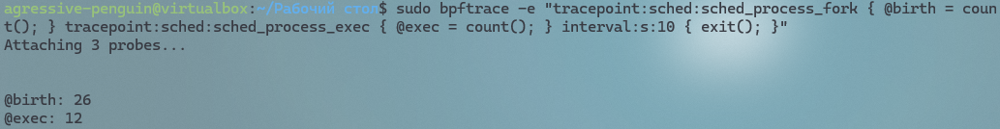
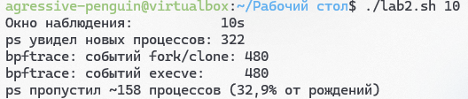
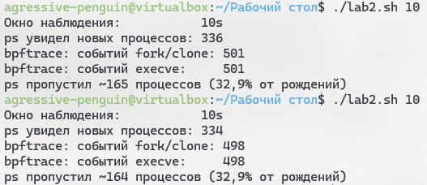

# Отчёт по лабораторной работе: «Почему bpftrace видит больше процессов, чем ps»

## Содержание

  - [1. Цель работы](#1-цель-работы)
  - [2. Окружение и установка](#2-окружение-и-установка)
  - [3. Проверка версий](#3-проверка-версий)
  - [4. Мониторинг через ps](#4-мониторинг-через-ps)
  - [5. Мониторинг через bpftrace](#5-мониторинг-через-bpftrace)
  - [6. Однострочник и «мусорные» процессы](#6-однострочник-и-мусорные-процессы)
  - [7. Скрипт lab2.sh](#7-скрипт-lab2sh)
  - [8. Результаты](#8-результаты)
  - [9. Выводы](#9-выводы)

## 1. Цель работы

Показать на практике, что утилита `ps`, снимающая снимок таблицы процессов, пропускает короткоживущие процессы, которые успевают родиться и умереть между двумя снимками. Утилита `bpftrace`, подписанная на tracepoints планировщика, видит **каждое** рождение процесса, поэтому её счётчик всегда больше.

Задачи:

- установить `bpftrace` и проверить версии инструментов;
- посчитать новые процессы через `ps` и через `bpftrace` за один и тот же интервал;
- объяснить расхождение и количественный пропуск `ps`.

## 2. Окружение и установка

Работа выполнялась на виртуальной машине с Debian 13. Установка `bpftrace`:

```bash
sudo apt update
sudo apt install -y bpftrace
```



---

## 3. Проверка версий

```bash
bpftrace --version
uname -a
```



---

## 4. Мониторинг через ps

Классический подход — снимать снимок таблицы процессов раз в интервал:

```bash
ps -e
```

Между двумя снимками короткоживущий процесс успевает родиться и умереть, и `ps` его никогда не увидит. Это и есть  причина, по которой `bpftrace` насчитывает больше. Ниже приведен вывод команд, из которого виден формат выдачи обычного `ps -e` и `ps aux`, как представителя полных команд.

.png)



---

## 5. Мониторинг через bpftrace

`bpftrace` подписывается на tracepoints планировщика:

- `sched_process_fork` — рождение процесса;
- `sched_process_exec` — исполнение программы;
- `tracepoint:sched:sched_process_fork` — то же через явный tracepoint.

Ниже показаны интересующие нас трейспоинты.



---

## 6. Однострочник и «мусорные» процессы

Для демонстрации короткоживущих процессов использовался однострочник, плодящий мусор:

```bash
sudo bpftrace -e 'tracepoint:sched:sched_process_fork { @birth = count(); } tracepoint:sched:sched_process_exec { @exec = count(); } interval:s:10 { exit(); }' & sleep 1; for i in $(seq 300); do /bin/true; done; wait
```

Триста `/bin/true` по 1–2 мс каждый — `ps` почти ни один не поймает, `bpftrace` посчитает все. На скрине видно 301 процесс (ведь есть еще сам процесс команды).



Далее была использована более "живая" система, с однострочником без мусора.

```bash
sudo bpftrace -e "tracepoint:sched:sched_process_fork { @birth = count(); } tracepoint:sched:sched_process_exec { @exec = count(); } interval:s:10 { exit(); }"
```

Результат его выполнения:



## 7. Скрипт lab2.sh

Полный текст скрипта, который использовался для измерений новых процессов во время окна:

```bash
#!/usr/bin/env bash
# Запуск: ./lab2.sh [секунды]   (по умолчанию 10)
set -euo pipefail

DURATION=${1:-10}        # окно наблюдения, сек
STEP=${STEP:-0.05}       # период опроса ps, сек
DIR=$(mktemp -d)         # временные файлы прогона
trap 'rm -rf "$DIR"' EXIT
: > "$DIR/bpf"; : > "$DIR/bpf.err"

# Часть 1. Отсекаем ядерные потоки: на Debian 13 ps печатает их БЕЗ скобок,
# поэтому главный признак - родитель kthreadd (PID 2); скобки - для других систем.
user_pids() {
    ps -eo pid=,ppid=,comm= | awk '$1 != 2 && $2 != 2 && $3 !~ /^\[/ { print $1 }'
}

poll_ps() {
    user_pids | sort -u > "$DIR/base"                 # кто уже был в начале
    local end=$((SECONDS + DURATION))
    while (( SECONDS < end )); do                     # цикл опроса (polling)
        user_pids >> "$DIR/seen"
        sleep "$STEP"
    done
    sort -u "$DIR/seen" | comm -13 "$DIR/base" - | wc -l   # новые PID за окно
}

sudo -v                                              # кешируем пароль sudo

poll_ps > "$DIR/ps" &                                # Часть 1 фоном
PS_PID=$!

if command -v bpftrace > /dev/null; then
    # Часть 2. Однострочник: события ядра sched_process_fork (рождение задачи,
    # т.е. fork/clone) и sched_process_exec (успешный execve).
    sudo bpftrace -e "tracepoint:sched:sched_process_fork { @birth = count(); } tracepoint:sched:sched_process_exec { @exec = count(); } interval:s:$DURATION { exit(); }" \
        > "$DIR/bpf" 2> "$DIR/bpf.err" &
    BPF_PID=$!
else
    echo "ВНИМАНИЕ: bpftrace не установлен, Часть 2 пропущена"
fi

wait "$PS_PID" || true
[ -n "${BPF_PID:-}" ] && wait "$BPF_PID" || true

ps_seen=$(tr -dc '0-9' < "$DIR/ps")
birth=$(awk '/@birth/ { print $NF }' "$DIR/bpf" "$DIR/bpf.err" | tail -1)
execs=$(awk '/@exec/ { print $NF }' "$DIR/bpf" "$DIR/bpf.err" | tail -1)

echo "Окно наблюдения:           ${DURATION}s"
echo "ps увидел новых процессов: ${ps_seen:-0}"
echo "bpftrace: событий fork/clone: ${birth:-0}"
echo "bpftrace: событий execve:     ${execs:-0}"
if [ -n "${birth:-}" ] && (( birth > ps_seen )); then
    awk -v b="$birth" -v p="$ps_seen" 'BEGIN { printf "ps пропустил ~%d процессов (%.1f%% от рождений)\n", b - p, (b - p) * 100 / b }'
fi
```

Запуск (делаем исполняемым и запускаем):

```bash
chmod +x lab2.sh
./lab2.sh 10
```

## 8. Результаты



```text
ps увидел новых процессов: 322
bpftrace: событий fork/clone: 480
bpftrace: событий execve:     480
ps пропустил ~158 процессов (32,9% от рождений)
```

Расшифровка:

- за 10 секунд опросный цикл сделал ~160 итераций; каждая рождает 3 процесса   (`ps`, `awk`, `sleep`) = 480 рождений, их и поймал bpftrace;
- `execve` тоже 480 — каждый рождённый сразу исполняет программу, сходимость идеальная (так как это чистый Debian без GUI);
- `ps` из каждой своей итерации гарантированно видит только `ps`+`awk` (они живут в момент снимка), а `sleep` и прочую мелочь — нет.

Почему всего 32,9%? ВМ почти простаивает, и главный источник процессов — сам измеритель. На живой системе пропуск легко уходит за 70%, но даже так bpftrace увидел в 1,5 раза больше.

Если же запустить на более живой системе (тот же Debian, но с GUI), то результаты будут иными (как минимум, теперь тут не только процессы измерителя), но так как он тоже простаивает, ничего "красивого" заснять не удалось, но пропусков `ps` все же чуть больше, и процессов рождено больше, чем от самого измерения.



## 9. Выводы

- `ps`, снимающий снимок таблицы процессов, пропускает короткоживущие процессы; `bpftrace`, подписанный на tracepoints планировщика, видит каждое рождение.
- За 10 с bpftrace насчитал 480 рождений против 322 у ps — пропуск 32,9%.
- На живой системе расхождение чуть больше, но в процентах почти такое же, ведь система недостаточно "живая".
- Эксперимент полностью подтвердил гипотезу работы.